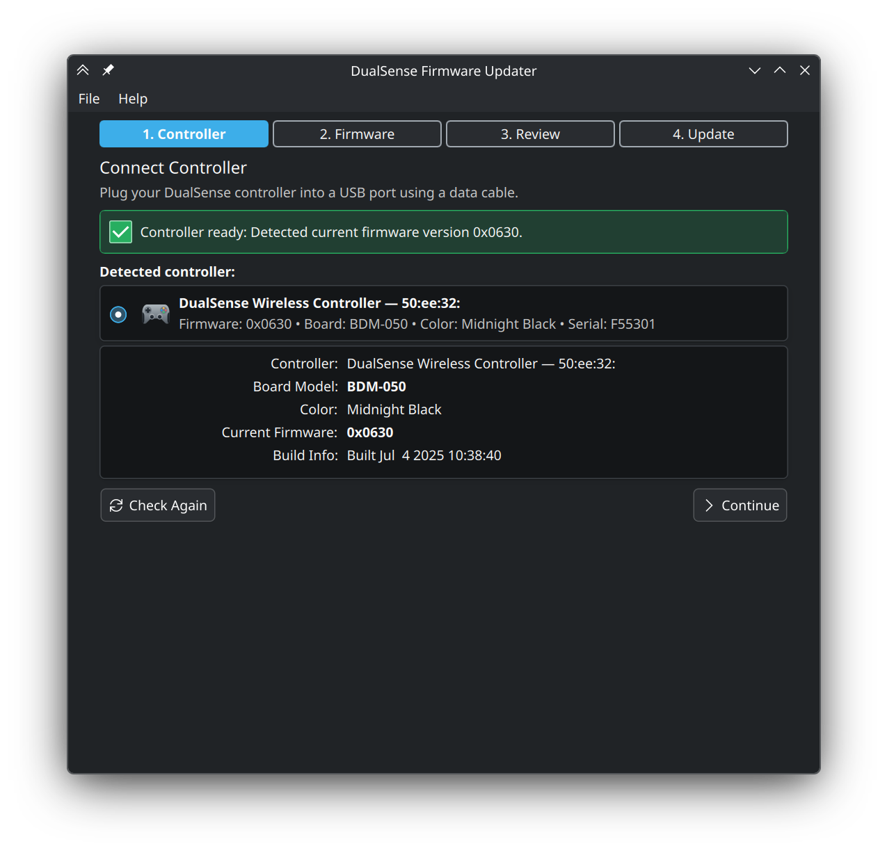

<!--
SPDX-FileCopyrightText: 2026 Azorimor <azorimor@gmail.com>

SPDX-License-Identifier: GPL-3.0-or-later
-->

# Linux DualSense Firmware Updater

An unofficial Linux KDE Kirigami desktop application ([`Azorimor/linux-dualsense-fw-updater`](https://github.com/Azorimor/linux-dualsense-fw-updater)) for inspecting and updating Sony PlayStation DualSense (`054c:0ce6`) and DualSense Edge (`054c:0df2`) controller firmware over USB HID.



## Disclaimer

This is not an official Sony application. If you can, use Sony’s official updater
for Windows instead. If you don’t have convenient access to a Windows machine,
you can try this tool.

Use at your own risk. Firmware upgrades are auto-committed by the controller
even if the verify and finalize steps are never run. There are no guarantees
this won’t brick your controller, though the device appears to verify the image
before committing, so a failed update would normally leave the current firmware
intact. This has only been tested on the standard DualSense, not the DualSense
Edge.

## Features & Guided GUI Workflow

Launch `dualsense-updater` and follow the four guided KDE Kirigami wizard steps:

1. **Controller** — Connects over a wired USB data cable (updates cannot run over Bluetooth) and automatically inspects all connected USB DualSense / DualSense Edge controllers, displaying:
   - Board revision (`BDM-020`, `BDM-030`, `BDM-040`, `BDM-050`, `BDM-060`, or `DualSense Edge`) and mapped hardware target (`0004`, `000B`, `000E`, `0044`)
   - Current firmware version, FW series, build date/time, serial number, controller shell color, and **battery level / charging status** (flagging low or critically low discharging batteries)
   - **Bluetooth-only detection hint**: if controllers are only connected over Bluetooth, displays tailored guidance to plug in a USB data cable
   - **Automatic background catalog check & live USB polling**: automatically checks Sony's catalog in the background once inspected to show live update availability, while background USB polling updates the UI automatically if controllers are disconnected or swapped while idle
2. **Firmware** — Choose either:
   - **Download Official Sony Firmware**: shows a clear current-vs-latest version comparison from Sony's catalog (`info.json`), downloads the latest official image automatically, and caches verified official `.bin` downloads in memory for reuse or saving to disk (**Save Firmware Copy…**).
   - **Use a Local Firmware File (`.bin`)**: validates the local file's Sony firmware header, embedded target ID, and USB PID against the selected controller—blocking incompatible images and warning on unverified headers before proceeding.
3. **Review** — Summarizes controller details, battery status, current and target firmware versions, and source; surfaces warnings for low/critically low discharging battery, unverified local image headers, same-or-newer firmware versions, or untested targets (DualSense Edge); and requires explicit confirmation that firmware updates cannot be reversed.
4. **Update** — Streams download progress (with safe cancellation before flashing begins), initializes the update, writes firmware blocks, verifies, and finalizes while blocking accidental window close/quit during active flashing. After flashing finishes, performs **post-flash hardware verification** to confirm the controller reports the expected firmware version and lets you save a cached official `.bin` copy (**Save Firmware Copy…**) for offline reuse. If an error occurs, plain-English recovery hints and `Scan Controllers` / `Try Again` / `Start Over` actions are shown.

- **Built-in About & Licenses Windows**: Open **Help → About Unofficial DualSense Firmware Updater** for version info and project links (GitHub repository, website, issue tracker), or **Help → Licenses** to inspect the bundled third-party crate notices, `GPL-3.0-or-later` license text, and `nchie` MIT attribution.
- **Optional Flash Run Reporting**: After a firmware update succeeds or fails, use **Flash Run Infos** or **Open GitHub Issue** to inspect or open a prefilled `[Flash Report]` GitHub issue containing anonymized OS, hardware revision, firmware version, and error metrics (never serial numbers or local file paths).

## Installation (Prebuilt Portable Archives)

Official [GitHub Releases](https://github.com/Azorimor/linux-dualsense-fw-updater/releases) distribute portable single-binary `.tar.gz` archives for both **`x86_64`** and **`aarch64` (ARM64)** Linux, dynamically linked against your host system's Qt 6, KDE Frameworks 6 Kirigami, and `libudev` libraries:

- **Portable Tarball (`x86_64` or `aarch64`)**:
  ```sh
  # Replace <arch> with x86_64 or aarch64
  tar -xzf linux-dualsense-fw-updater-<tag>-<arch>.tar.gz
  cd linux-dualsense-fw-updater-<tag>-<arch>
  ./dualsense-updater
  ```
  To register the `.desktop` entry and hicolor icons (`16x16`–`512x512` + `scalable`) from the extracted tarball directory, run:
  ```sh
  ./install-desktop.sh
  ```
  By default this installs into `${XDG_DATA_HOME:-$HOME/.local/share}` and points `Exec=` at `./dualsense-updater` when no `dualsense-updater` binary is already on `PATH`. Pass `--system` (with `sudo`) for `/usr/local/share`, `--prefix DIR`, `--exec PATH`, or `--uninstall` to remove the entry and icons.

> **Official Distribution Policy:** Official releases are distributed **only** as portable `.tar.gz` archives on [GitHub Releases](https://github.com/Azorimor/linux-dualsense-fw-updater/releases) (prebuilt AppImages are not published; building an AppImage remains an optional local build from source below). Any third-party store or distribution packages (such as Flatpak, AUR, Snap, etc.) are community-maintained and not officially published by this project.

> **USB Permissions (`udev`)**: On Linux, you may need udev rules granting your user read/write access to DualSense HID devices (`/dev/hidraw*` / USB vendor ID `054c`) to inspect or flash without root privileges.

## Building from Source

### Linux Build Prerequisites

- **Rust toolchain** (Edition 2024, MSRV `1.85.0`) and a **C++17 / `clang` toolchain** (for `cxx` / `cxx-qt-build`)
- **`mold` linker** (configured for Linux targets via `.cargo/config.toml` with `-C link-arg=-fuse-ld=mold`)
- **Qt 6** development packages: `Qt6Core`, `Qt6Gui`, `Qt6Qml`, `Qt6Quick`, `Qt6QuickControls2`, and `qmake6`
- **KDE Frameworks 6 (KF6) runtime QML modules**: `Kirigami` (`org.kde.kirigami`) and `qqc2-desktop-style` (`org.kde.desktop`; falls back to Qt `Fusion` style if unavailable, or override with `QT_QUICK_CONTROLS_STYLE`)
- **Linux USB/GL system libraries**: `libudev-dev` (required for the statically compiled `hidapi` `linux-static-hidraw` backend, which dynamically links host `libudev.so.1`), `libusb-1.0-0-dev`, `libgl-dev`, `libxkbcommon-dev`, and `pkg-config` (Ubuntu 24.04)

### `qmake6` Note

`build.rs` automatically uses `/usr/bin/qmake6` when `QMAKE` is unset and `/usr/bin/qmake6` exists. If your distribution's default `qmake` points to Qt 5 or `qmake6` is installed elsewhere, export `QMAKE` explicitly:

```sh
export QMAKE=/usr/bin/qmake6
```

### Build & Run

```sh
QMAKE=/usr/bin/qmake6 cargo build --release
./target/release/dualsense-updater
```

Or run directly from the workspace root:

```sh
QMAKE=/usr/bin/qmake6 cargo run --release
```

Logging uses `env_logger` (default `info`). Set `RUST_LOG=debug` for verbose HID and update diagnostics.

#### Debug Simulation & Native File Dialogs

- **Simulation mode (`--no-flash[=success|error]`)**: Pass `--no-flash` (or `--no-flash=success` / `--no-flash=error`) to exercise the full wizard and progress/error UI without writing firmware to real hardware. When no physical USB DualSense is attached, a simulated `BDM-050` controller (`0x0400`) is provided automatically; real attached controllers remain readable for inspection while `0xF4` flash commands are blocked. Run `dualsense-updater --help` for full usage.
- **Native desktop file picker**: The application runs on `QApplication` (`QtWidgets`) and automatically configures `QT_QPA_PLATFORMTHEME=xdgdesktopportal` inside AppImage bundles so open/save dialogs use the host desktop's native KDE/GTK/XDG portal file picker instead of Qt's fallback QML dialog.

### Opt-In Verification Against Real Sony Firmware Binaries

To verify firmware parsing, header validation, catalog matching, and simulated HID chunking against real official Sony `.bin` firmware files (kept strictly local and never committed or run on GitHub CI):

1. Place one or more official Sony `.bin` images (for example `FWUPDATE000B.bin`, `FWUPDATE0004.bin`, `FWUPDATE000E.bin`, or `FWUPDATE0044.bin`) inside the gitignored `tmp/` directory at the repository root — or point `DUALSENSE_REAL_FW_PATH` at a `.bin` file elsewhere on disk.
2. Run the feature-gated integration test suite:

```sh
cargo test -p dualsense-core --features real-firmware-tests --test real_firmware_test
```

Default `cargo test --workspace` and GitHub Actions CI omit `--features real-firmware-tests`, so CI stays self-contained without proprietary firmware binaries.

### Desktop Entry & Icon Installation (From Source)

After installing or placing `dualsense-updater` on your `PATH` (or passing `--exec`), install the XDG desktop entry (`io.github.azorimor.linux_dualsense_fw_updater`) and hicolor icon theme (`16x16`–`512x512` PNGs and `scalable/icon.svg`) using:

```sh
./packaging/linux/install-desktop.sh              # installs into ~/.local/share (default)
./packaging/linux/install-desktop.sh --exec "$PWD/target/release/dualsense-updater"
sudo ./packaging/linux/install-desktop.sh --system
```

Use `./packaging/linux/install-desktop.sh --uninstall` (with `--system` or `--prefix DIR` if applicable) to remove the installed `.desktop` file and icons.

### Packaging Locally (Tarball & Optional AppImage)

Official CI/GitHub Releases publish only the portable `.tar.gz` archive (`--tarball-only`). If you clone the repository, you can package the portable `.tar.gz` or optionally build a local `.AppImage` into `dist/`:

```sh
./scripts/package-appimage.sh --tarball-only target/release/dualsense-updater v0.1.0 dist
# Optional local AppImage build (requires local Qt6 + KF6 Kirigami and linuxdeploy):
./scripts/package-appimage.sh target/release/dualsense-updater v0.1.0 dist
```

Desktop integration assets live in `packaging/linux/io.github.azorimor.linux_dualsense_fw_updater.desktop`, `packaging/linux/install-desktop.sh`, and `packaging/linux/icons/` (`16x16`, `22x22`, `32x32`, `48x48`, `64x64`, `128x128`, `256x256`, `512x512` PNGs plus `scalable/icon.svg`). `scripts/package-appimage.sh` bundles the hicolor icons, `.desktop` file, `install-desktop.sh`, `THIRD_PARTY_NOTICES.txt`, and `LICENSES/` into the `.tar.gz` (and `.DirIcon` / `AppDir` for optional local AppImage builds).

## Testing, Coverage, and Structural Checks

All workspace unit and integration tests run headlessly without a display server, GPU, or attached DualSense controller:

```sh
cargo fmt --check
cargo clippy --workspace --all-targets -- -D warnings
python3 scripts/verify_structural_rules.py
cargo test --workspace
```

License and FSFE REUSE compliance checks (`reuse` and `cargo-deny` using `deny.toml` and `REUSE.toml`):

```sh
reuse lint
cargo deny --locked --all-features check licenses
```

To verify QML loading against the offscreen Qt platform plugin in headless environments:

```sh
QT_QPA_PLATFORM=offscreen timeout 5s cargo run
```

To generate workspace code coverage reports (requires `cargo-llvm-cov` and the `llvm-tools` rustup component):

```sh
./scripts/coverage.sh
```

This writes LCOV data to `target/coverage/lcov.info`, HTML reports to `target/coverage/html/index.html`, and prints a workspace summary table.

GitHub Actions workflows under `.github/workflows/` (`ci.yml`, `release.yml`, `deploy-website.yml`, `cleanup-pr-cache.yml`) target `ubuntu-24.04` and run on both manual `workflow_dispatch` and automatic pull-request, tag, release, and GitHub Pages triggers. In `ci.yml`, fast checks (`reuse`, structural validation, `cargo fmt --check`, `cargo-deny`) gate the heavier Qt6/Rust `clippy` + single-pass test/coverage job (`./scripts/coverage.sh --locked`).

## Sony Firmware Sources & Hardware Targets

Sony publishes the latest version metadata at:

```text
https://fwupdater.dl.playstation.net/fwupdater/info.json
```

Observed board-to-target mappings:

- DualSense BDM-020 -> `0004`
- DualSense BDM-030 -> `0004`
- DualSense BDM-040 -> `0004`
- DualSense BDM-050 -> `000B`
- DualSense BDM-060 -> `000E`
- DualSense Edge -> `0044`

In practice, attempting to flash firmware for the wrong SoC target fails verification rather than bricking the controller.

Firmware images can be downloaded directly from:

```text
https://fwupdater.dl.playstation.net/fwupdater/fwupdate<target>/<version>/FWUPDATE<target>.bin
```

Example: to get version `0x0630` for DualSense BDM-050 (`000B`):

```text
https://fwupdater.dl.playstation.net/fwupdater/fwupdate000B/0x0630/FWUPDATE000B.bin
```

## Notes

- A controller already running the latest firmware may not return success codes past the start-update phase; this is expected because Sony's firmware blocks downgrades/re-flashing the same version.
- On Linux, you may need udev permissions to access DualSense HID devices (`/dev/hidraw*` / USB VID `054c`) without root privileges.

## License & Acknowledgments

**Linux DualSense Firmware Updater** is licensed under the **GNU General Public License v3.0 or later (`GPL-3.0-or-later`)** and complies with the [FSFE REUSE](https://reuse.software/) specification (see `LICENSES/`, `REUSE.toml`, and `packaging/linux/THIRD_PARTY_NOTICES.txt`).

The core DualSense USB HID protocol and firmware update backend logic in `crates/dualsense-core` is adapted from the original CLI project by [nchie](https://github.com/nchie/dualsense-updater-rs) under the MIT License and remains licensed under **`MIT AND GPL-3.0-or-later`**.

### Third-Party Notices & Source Availability

Prebuilt portable `.tar.gz` releases dynamically link against your host system's **Qt 6** (`LGPL-3.0-only` / `GPL-3.0-only`, used under `LGPL-3.0-only`), **KDE Frameworks 6 Kirigami** (`LGPL-2.0-or-later` / `LGPL-2.1-or-later` / `LGPL-3.0-only` / `BSD-3-Clause`), and **`libudev`** (`libudev.so.1`). Statically linked dependencies include vendored C **`hidapi`** (`Alan Ott / signal11 & libusb maintainers`, `BSD-3-Clause OR GPL-3.0-only OR LicenseRef-HIDAPI-Orig`, compiled via the `hidapi` crate's `linux-static-hidraw` backend), **`cxx-qt` / `cxx-qt-lib`** (`Klarälvdalens Datakonsult AB (KDAB)`, `MIT OR Apache-2.0`), and the Rust crates listed in `Cargo.lock` (embedded with full copyright notices and license texts inside **Help → Licenses**).

Full license texts (`GPL-3.0-or-later.txt`, `MIT.txt`, `Apache-2.0.txt`, `LGPL-3.0-only.txt`, `LGPL-2.1-or-later.txt`, `LGPL-2.0-or-later.txt`, `BSD-3-Clause.txt`) and `THIRD_PARTY_NOTICES.txt` are included in every `.tar.gz` archive. Complete Corresponding Source code is available via:

- **Application & build scripts (`GPL-3.0-or-later`)**: https://github.com/Azorimor/linux-dualsense-fw-updater
- **Qt 6 (`LGPL-3.0-only` / `GPL-3.0-only`)**: https://code.qt.io/cgit/qt/
- **KDE Frameworks Kirigami (`LGPL-2.0-or-later` / `LGPL-2.1-or-later` / `LGPL-3.0-only` / `BSD-3-Clause`)**: https://invent.kde.org/frameworks/kirigami
- **hidapi (`BSD-3-Clause` / `GPL-3.0-only` / HIDAPI)**: https://github.com/libusb/hidapi
